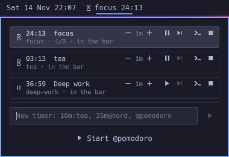
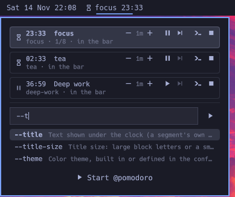

# tminus

An [Omarchy](https://omarchy.org/) bar widget for
[tminus](https://github.com/seagleNet/tminus) (`t-`), the terminal countdown
timer:

- **In the bar:** the newest running timer, with or without a window,
  including `--headless` ones that live only in the bar. Click to pause,
  scroll to add or take time. The final seconds pulse in the theme's urgent
  color. While no timer runs, an hourglass starts a pomodoro (see `start`).
- **In its popup:** every running timer with its controls, a way to open any of
  them in a terminal with the big clock and effects, and a field to start
  another one, with `t-`'s own completion.


 

## Requirements

- Omarchy with the Omarchy shell (omarchy-shell)
- tminus 0.4 or later
  ([install instructions](https://github.com/seagleNet/tminus#install)) on the
  login shell's `PATH`, or set the `command` setting to where it is

## Install

```sh
omarchy plugin add https://github.com/seagleNet/omarchy-tminus --enable
omarchy restart shell
```

This installs it to `~/.config/omarchy/plugins/seaglenet.tminus` and puts it
beside the clock. Move it with
`omarchy bar move seaglenet.tminus --section right`.

The shell keeps running a widget's old code after an update until it restarts,
so restart it after `omarchy plugin update seaglenet.tminus` too.

## Using it

In the bar:

| Action | Effect |
|---|---|
| Left click | pause / resume; starts the next segment while one waits (`--confirm`); dismisses a finished timer |
| Middle click | next segment |
| Right click | the popup |
| Scroll up / down | add / take time (`step`, 1 minute by default) |
| Hover | title, segment, what comes next, the timer's name |

Paused timers are dimmed; a finished timer uses the theme's urgent color. On a
vertical bar it shows only the icon.

In the popup, each running timer has a row; past four, the list scrolls:

- **The row:** click it to show that timer in the bar instead of the newest,
  until it ends. Hover cut-off text to read all of it.
- **− 1m +:** take away or add `step`.
- **Pause / next:** pause or resume; skip to the next segment.
- **`>_`:** a bar-only timer opens in a terminal with its clock and effects
  (`t- ctl attach`): keys there control the timer, and `q` closes only the
  window. A timer with a window gets that window focused.
- **Stop:** ends the timer.

Below the list, type `t-` arguments and press Enter to start another timer,
always `--headless`: `10m:tea`, `25m:work@nord 5m:break x4`,
`@pomodoro -t "Deep work"`. Tab completes from `t-` (presets after `@`,
themes, options), Up and Down pick a suggestion, Escape closes. The words go to
`t-` as they are, never to a shell. `t- --check` looks at them first, so a
mistake shows under the field.

## Settings

Set them on the widget's entry in `~/.config/omarchy/shell.json`; changes apply
on save:

```json
{ "id": "seaglenet.tminus", "step": "5m", "start": "25m:work 5m:break x4 --notify" }
```

| Key | Default | Meaning |
|---|---|---|
| `command` | `t-` | The tminus binary, if the login shell's `PATH` doesn't have it (e.g. `~/.cargo/bin/t-`) |
| `name` | | Follow only the timer with this name (`t- -n NAME`); empty follows the newest |
| `step` | `1m` | Time added or taken per scroll notch and per stepper click |
| `start` | `@pomodoro` | While no timer runs, an icon stays in the bar, and the popup gets a start button; both run `t- <start> --headless`. `""` hides the widget while no timer runs |

The widget may be added more than once, e.g. one per named timer.

The start field accepts every `t-` option, including `--exec`, which runs a
shell command when the timer ends: it is as capable as a terminal, running as
you.

## Uninstall

```sh
omarchy plugin remove seaglenet.tminus
```

Running timers aren't touched; stop them with `t- ctl stop --all`.

## Development

Install a working copy by copying it over the installed plugin (symlinks are
refused), then restart the shell: saving a file restarts the widget, but with
the QML the shell already loaded, even after `omarchy-shell shell
reloadPlugins`.

```sh
cp -r BarWidget.qml Logic.js manifest.json i18n ~/.config/omarchy/plugins/seaglenet.tminus/
omarchy restart shell
```

The widget's console output goes to the journal:
`journalctl --user -t omarchy-shell`.

`BarWidget.qml` holds the UI and the processes; `Logic.js` holds the plain
logic (parsing what `t-` prints, splitting what the user types), which the
tests run under node. QML and JavaScript are formatted with Qt's `qmlformat`
using the checked-in `.qmlformat.ini`:

```sh
/usr/lib/qt6/bin/qmlformat -i BarWidget.qml Logic.js
```

The checks CI runs, on every push and pull request (qmllint needs Omarchy's
shell to resolve the `qs.*` imports; CI unpacks it from the edge `omarchy`
package):

```sh
mkdir -p /tmp/imports && ln -sfn /usr/share/omarchy/shell /tmp/imports/qs
/usr/lib/qt6/bin/qmllint -I /tmp/imports BarWidget.qml Logic.js   # settings in .qmllint.ini
node --test tests                                                  # Logic.js
```

The security workflow runs Semgrep and zizmor. A finding fails the job and
shows up in its log.

## License

[MIT](LICENSE)
